# こんにちは！kume です 👋

**金沢工業大学 情報工学科**　|　ものづくりが好きなエンジニア志望

---

## 🙋 About

金沢工業大学 情報工学科。Web・モバイル・デスクトップ・CLI と幅広く開発。  

**Languages:**

  

生成AI・AIエージェントを活用した設計・実装・検証にも取り組んでいます。

**Tools:**

  

**Communication / Protocols:**

複数プロジェクトで端末間通信の設計・実装を繰り返し担当してきた結果、以下のプロトコル・通信方式に理解がある。

---

## 🚀 制作物

> 📝 **掲載リポジトリのドキュメント（README・技術仕様書）はすべて私が執筆しています。**

---

## 🏆 ハッカソン

#### [4DX@HOME](https://github.com/jphacks/kz_2504) — JPHacks 2025

**AI動画解析による家庭用4DXシステム。** 任意のMP4動画をGemini 2.5 Pro Visionで解析し、振動・光・風・水・色の5種類の物理フィードバックを自動生成。  
Webアプリ（React + TypeScript） × Cloud Run API（FastAPI） × Raspberry Pi Hub × ESP-12E × 4台の3層アーキテクチャ。  
映像と物理効果の同期誤差は **±100ms以内**。3Dプリント筐体も自作。  
担当：**APIサーバー構築 / WebアプリとRaspberry Pi双方の通信制御・実装**。

> 🔗 [Live Demo](https://kz-2504.onrender.com)

>      

> 📝 **README・技術仕様書（5種）を執筆**

---

#### [Screact](https://github.com/KIT-DevelopersHub/screact) — THE HACK 2026

**既存のモニターやプロジェクターを、指で描いて操作できる画面へ。** Androidスマホで手指を認識し、PC上の画面へ描画・クリック・スクロールなどの操作を反映。  
MediaPipeによる手指認識、ArUcoとHomographyによる画面座標変換、One-Euro Filterによる平滑化を組み合わせ、UDP自動発見とWebSocketでスマホとPCを接続。  
**THE HACK 2026 本戦で大賞を受賞**。

> 🔗 [デモ動画（約33秒）](https://drive.google.com/file/d/14SZvVKVLxcpKkB3tEl41TTzPK-4H_XEj/view?usp=sharing)

>     

> 📝 **README・Android / Desktop / 通信仕様書を執筆**

---

#### [Re:Cooplay](https://github.com/jphacks/kz_2613) — JPHACKS 2026

**1人用のPCゲームに、複数人の協力プレイを後付けするシステム。** 1つのキャラクターの移動・視点・攻撃などを2〜4人で役割分担し、ゲーム本体を改造せずに共同操作。  
スマホのブラウザから参加し、ゲームや人数に応じて操作を割り当て。Rust製PCホストで入力を統合し、WebRTC DataChannel・WebSocketとWindows APIを活用。  
**JPHACKS 2026 金沢会場 Hack Day Audience Awardを受賞**。

> 🔗 [紹介動画](https://youtu.be/a8uhU2ymsuQ)

>     

> 📝 **README・総合仕様書・通信仕様書を執筆**

---

#### [omoi](https://github.com/Ruaku1352/omoi) — Tornado 2026

**一枚の写真ではなく、一つの思い出を飾る。** 複数の写真と思い出テキストから、AIが人物・場所・物などの要素を選び、多層の立体レイヤーアートへ再構成。  
React製Webアプリで3Dプレビューと2D編集を行い、FastAPI・Gemini・画像処理で作品データを生成。実際に飾れる物理作品への出力にも対応。  
**Tornado 2026でNTTレゾナントテクノロジー賞を受賞**。

> 🔗 [Live Demo](https://omoi-506412.web.app/)

>     

> 📝 **README・システム仕様書・ギャラリーを執筆**

---

#### [EnCounter](https://github.com/razy6174/EnCounter) — スマプロハッカソン 2026

**ハイパーローカル・すれちがいマッチングアプリ。** BLE（Bluetooth Low Energy）で半径数メートル以内の「すれ違い」をリアルタイム検知し、気分(Mood)と興味タグが一致した時だけマッチング通知。  
位置情報不要・匿名認証・ステルスモード搭載。チャット、すれちがい図鑑、鼓動風バイブレーション通知を実装。  
担当：**バックエンド / アーキテクチャ設計 / BLE通信 / Firebase連携**。

>      

> 📝 **README・バックエンド仕様書・フロントエンド仕様書を執筆**

---

#### [Sleep Buster](https://github.com/Saisei2004/WILDCARD) — Hackit 2025

**みんなの朝を「つなぐ」アラームアプリ。** 友達が遠隔操作でロボット「バスタ君」（LEGO EV3製）を動かし、寝坊した人を**物理的に**たたき起こす。  
SkyWay WebRTCによるリアルタイム映像確認、Firebase経由の起床ステータス同期、Bluetooth制御を実装。  
8チームが参加する学内ハッカソン「Hackit 2025」で **最優秀賞を受賞**。  
担当：**SkyWay WebRTCによるリアルタイム映像確認の実装**。

>     

> 📝 **README・システム仕様書（全15章）を執筆**

---

### 🌐 個人開発 & Chrome 拡張

| プロジェクト | 概要 | 技術 |
|---|---|---|
| [**Shortcut Manager**](https://github.com/Soki0909/windows-shortcut-manager) | Windowsのショートカットキーにアプリ・Webサイト・Chromeタブグループなどを割り当てる管理ツール（正式版準備中） |   |
| [**ポートフォリオサイト**](https://github.com/Soki0909/Soki0909.github.io) | 自作ポートフォリオサイト ([公開中](https://soki0909.github.io/)) |  |
| [**happy-chicken-ticket-system**](https://github.com/Soki0909/happy-chicken-ticket-system) | 工大祭屋台で使用したQRコードベースのリアルタイム整理番号管理システム |  |
| [**pdf_to_markdown**](https://github.com/Soki0909/pdf_to_markdown) | PDFをMarkdown形式に変換するCLIツール |  |
| [**KyoinAssist**](https://github.com/Soki0909/KyoinAssist) | 出欠や生徒情報の管理を支援するAndroidアプリ（授業制作） |  |
| [**sum-equals-concat**](https://github.com/Soki0909/sum-equals-concat) | 数列の和が両端の整数を連結した数に等しくなる組を探索するプログラム |  |
| [**PianoApp**](https://github.com/Soki0909/PianoApp) | OpenGLで制作した3D電子ピアノ |  |
| [**subject_semester_sorter**](https://github.com/Soki0909/subject_semester_sorter) | KITナビ上で年度・学期の履修科目を一覧表示（Chrome拡張） |  |
| [**kit_navi_autofocus**](https://github.com/Soki0909/kit_navi_autofocus) | 大学ポータルのログイン・ナビ操作を自動化（Chrome拡張） |  |
| [**think_before_ai**](https://github.com/Soki0909/think_before_ai) | 生成AIサイトを開く前に「本当に必要？」と問いかけるポップアップ（Chrome拡張） |  |
| [**Quick Tab Mover**](https://github.com/Soki0909/quick-tab-mover) | キーボード操作でChromeのタブを別ウィンドウへ移動・タブ間ジャンプ（Chrome拡張） |  |
| [**Shortcut New Tab**](https://github.com/Soki0909/shortcut-newtab) | 新規タブをキーボード中心のランチャーへ置き換えるChrome拡張 |  |
| [**Focus Escape**](https://github.com/Soki0909/focus-escape) | Webページ上のフォーカスをショートカットキーで解除するChrome拡張 |  |

---

## 📊 GitHub 統計

---

**訪問ありがとうございます！** 気になるリポジトリがあれば ⭐ をもらえると嬉しいです 😊

